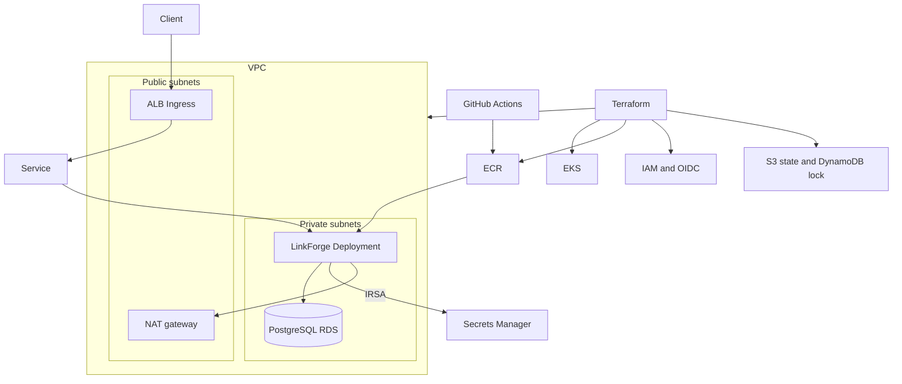

# LinkForge

A URL shortener you can try in the browser, with the API, container, Helm chart, and Terraform that run the same service on Amazon EKS.

**Live demo:** [https://taha080.github.io/aws-eks-devops-platform/](https://taha080.github.io/aws-eks-devops-platform/)

[](https://github.com/taha080/aws-eks-devops-platform/actions/workflows/ci.yml)
[](LICENSE)

Built by [Taha Ahsan](https://github.com/taha080).

## What it is

LinkForge stores a long web address under a short code and sends visitors to the original address. The project has two parts that do that job in different places:

- The [GitHub Pages site](https://taha080.github.io/aws-eks-devops-platform/) is a static page. By default it keeps your links in the browser. A short link looks like `#/code` on that page. You can point the page at a running API if you have one.
- The API in `app/` is a Python service. It stores links in SQLite or PostgreSQL, counts clicks, and answers HTTP. The rest of the repository packages that service: a container image, a Helm chart, Terraform for AWS, and GitHub Actions workflows.

The Pages site is the public demo. It runs in the browser and calls a LinkForge API only after you give it an address.

## Features

- Create a short link, with your own code or a generated one.
- Open the short link and get an HTTP 302 redirect. Each successful redirect adds one to the click count.
- List and delete links. List results are newest first, with a limit and offset.
- Health, readiness, and Prometheus metrics endpoints for probes and scraping.
- Optional bearer-token protection on the write and management routes. Redirects, probes, and metrics stay open.
- JSON logs on standard output, with a request id on each response.
- A browser demo that follows the same code and URL rules, and can call the API.
- A non-root container image, a Helm chart for Kubernetes, and Terraform modules for a private-node EKS platform.

## How it works

### The API

The service is a FastAPI application. On startup it opens the database, creates the `links` table if needed, and serves HTTP. Each link stores a code, the target URL (up to 2048 characters), a click count, and a creation time.

Codes are 3 to 32 characters: letters, digits, hyphens, and underscores. If you leave the code out, the API generates a 7-character code from letters and digits and tries up to five times when a candidate is already taken. These names are reserved, so they cannot be short codes: `healthz`, `readyz`, `metrics`, `docs`, `redoc`, and `openapi`.

A redirect looks up the code, increments `clicks`, and returns 302 with the target URL. Unknown codes return 404.

Interactive docs are the usual FastAPI pages at `/docs` and `/redoc`.

| Method | Path | What it does |
| --- | --- | --- |
| `GET` | `/healthz` | Liveness. Returns `{"status":"ok"}`. |
| `GET` | `/readyz` | Readiness. Runs `SELECT 1`. Returns 503 when the database check fails. |
| `GET` | `/metrics` | Prometheus metrics for this process. |
| `POST` | `/v1/links` | Create a link. Returns 201 and a `Location` header. |
| `GET` | `/v1/links` | List links. `limit` is 1–100 (default 20). `offset` defaults to 0. |
| `GET` | `/v1/links/{code}` | Fetch one link. |
| `DELETE` | `/v1/links/{code}` | Delete a link. Returns 204. |
| `GET` | `/{code}` | Redirect with 302 and count the click. |

When `LINKFORGE_API_TOKEN` is empty, the link routes accept requests with no token. That is the local default. When the token is set, create, list, fetch, and delete require `Authorization: Bearer`. The token is compared with `secrets.compare_digest`. Redirects, `/healthz`, `/readyz`, and `/metrics` stay public.

Every response includes `x-request-id`. The service uses the incoming header when the client sent one, and otherwise generates an id. Request logs are JSON. Probe and metrics requests are logged at debug; other requests are logged at info.

Set `LINKFORGE_CORS_ORIGINS` to a comma-separated list of origins to allow browser calls. The allowed methods are GET, POST, and DELETE.

Metrics use a registry created for that process, so tests do not share counters. The names are `linkforge_http_requests_total`, `linkforge_http_request_duration_seconds`, `linkforge_links_created_total`, and `linkforge_redirects_total` (labeled `hit` or `miss`).

### The browser demo

`web/` is a static site. With no API configured, creating a link writes it to `localStorage`, keeping the newest 200. Opening `#/code` counts a click in the browser and then redirects. If the browser asks for reduced motion, the page waits until you choose Continue. The page and the API use the same limits: http and https only, 2048 characters, and the same code pattern and reserved names.

The “Use a LinkForge API” panel, or a `?api=` query on the page URL, switches the page to `POST /v1/links`, `GET /v1/links`, and `DELETE /v1/links/{code}`. Open then follows the API redirect. A bearer token, if you type one, stays in this browser. The API must list this page’s origin in `LINKFORGE_CORS_ORIGINS`.

### Stack

| Piece | What this repo uses |
| --- | --- |
| API | Python 3.11 or newer (3.12 in CI and in the image), FastAPI, Uvicorn, Pydantic Settings, SQLAlchemy, psycopg, boto3, prometheus-client |
| Checks | pytest, ruff, bandit, Hadolint, Trivy |
| Image | Multi-stage `python:3.12-slim` build, user `10001`, SQLite file under `/data` |
| Local cluster | kind, kubectl, Helm |
| Cloud | Terraform 1.6 or newer, AWS provider 6.x, and TLS provider 4.x: VPC, EKS, ECR, IAM OIDC (IRSA), optional RDS, S3 state, DynamoDB lock |
| Delivery | Helm chart and GitHub Actions |

### Architecture

Terraform builds the AWS account. GitHub Actions can build the image, push it to ECR, and install the Helm release. The chart runs the API on EKS. Nodes and, in prod, PostgreSQL sit in private subnets.



The managed node group uses Amazon Linux 2023 and lives in the private subnets. The cluster enables the `vpc-cni`, `coredns`, and `kube-proxy` addons. Kubernetes secrets are encrypted with a customer-managed KMS key. Control-plane logs (`api`, `audit`, `authenticator`) go to CloudWatch.

Public subnets are tagged for internet-facing load balancers. `map_public_ip_on_launch` is false. Private subnets use NAT for outbound traffic. Dev uses one NAT gateway across two availability zones. Prod uses one NAT gateway in each of three zones and turns on VPC flow logs.

The Kubernetes API is private by default (`endpoint_private_access` is on, `endpoint_public_access` is off). To use `kubectl` from a laptop, set `endpoint_public_access` and limit `public_access_cidrs` to that network. The example files in `infra/envs/*/terraform.tfvars.example` show placeholders for those settings.

Dev and prod differ on purpose:

| | Dev | Prod |
| --- | --- | --- |
| VPC | `10.20.0.0/16`, 2 zones, one NAT | `10.30.0.0/16`, 3 zones, NAT per zone |
| Nodes | `t3.small`, desired 2 (min 1, max 3) | `t3.medium`, desired 3 (min 2, max 6) |
| Kubernetes | 1.35 | 1.35 |
| Database | SQLite on an emptyDir, one replica | Private PostgreSQL 16, Multi-AZ `db.t4g.small` |
| Chart | Ingress on, HPA and PDB off | Two or more replicas, HPA, PDB, network policy |
| Flow logs | Off | On |

SQLite on an emptyDir is local to one pod and disappears when that pod is replaced. The Helm chart refuses to render more than one replica, or an HPA, unless `database.external` is true.

The chart runs the container as UID 10001 with a read-only root filesystem, dropped capabilities, and a runtime-default seccomp profile. Probes call `/healthz` (liveness and startup) and `/readyz` (readiness). Pods are annotated for Prometheus scraping. A ServiceMonitor is included in the chart and left off unless you enable it.

The Ingress class is `alb`, with the usual AWS Load Balancer Controller annotations. The Terraform modules leave that controller for you to install; until it is installed, `kubectl port-forward` reaches the Service. Sample hostnames in the values files (`links.dev.example.com`, `links.example.com`) are placeholders.

RDS, when enabled, is not publicly accessible. Only the EKS cluster security group may connect on port 5432. RDS generates the master password and stores it in Secrets Manager. The database name and username are `linkforge`. The IRSA role on the `linkforge` service account in the `linkforge` namespace may read that secret. In prod the deploy workflow can also copy the connection URL into a Kubernetes Secret named `linkforge-db`.

The module description records that EKS 1.35 is the version these environments pin, and that 1.37 was the latest standard-support release as of October 2026. The upgrade policy is `STANDARD`. Cluster deletion protection is off so a demo can be removed. ECR image tags are immutable, scan on push, and the repository allows force-delete so a destroy is not blocked by leftover images.

### Configuration

Settings come from environment variables prefixed with `LINKFORGE_`, or from a `.env` file. Unknown variables are ignored.

| Variable | Default | Role |
| --- | --- | --- |
| `LINKFORGE_ENVIRONMENT` | `local` | Stored on the process settings. Compose and the chart set it. Request handling does not branch on the value. |
| `LINKFORGE_LOG_LEVEL` | `INFO` | Root log level. |
| `LINKFORGE_HOST` | `127.0.0.1` | Bind address. The image sets `0.0.0.0`. |
| `LINKFORGE_PORT` | `8000` | Listen port. |
| `LINKFORGE_BASE_URL` | `http://127.0.0.1:8000` | Prefix used to build `short_url`. |
| `LINKFORGE_DATABASE_URL` | empty | SQLAlchemy URL. When set, it wins. |
| `LINKFORGE_DB_SECRET_ARN` | empty | RDS-managed secret to read when the URL is empty. |
| `LINKFORGE_AWS_REGION` | empty | Region for that Secrets Manager call. |
| `LINKFORGE_API_TOKEN` | empty | Bearer token for link management routes. |
| `LINKFORGE_CORS_ORIGINS` | empty | Comma-separated browser origins. |

Database choice, in order:

1. `LINKFORGE_DATABASE_URL`, if it is set. Use `sqlite:///...` or `postgresql+psycopg://...`.
2. Otherwise `LINKFORGE_DB_SECRET_ARN`. The process calls Secrets Manager with the default AWS credential chain (IRSA on EKS) and builds a `postgresql+psycopg://` URL from the username, password, host, port, and database name in that JSON.
3. Otherwise a local file, `sqlite:///./data/linkforge.db`.

`scripts/render-db-url.py` does the same URL conversion from JSON on stdin. When the stack publishes an RDS secret ARN, the deploy workflow uses the script and stores the URL in the Kubernetes Secret.

### CI/CD

Three workflows live in `.github/workflows/`. Dependabot opens weekly updates for pip, GitHub Actions, and Terraform.

**CI** (`.github/workflows/ci.yml`) runs on pull requests and on pushes to `main`. Its permissions are contents read-only. Jobs:

- Ruff and pytest on Python 3.12
- `terraform fmt -check` and `terraform validate` with `-backend=false` for bootstrap, dev, and prod (provider plugins download during init; validate makes no AWS API calls)
- `helm lint` and `helm template` for the default, dev, prod, and kind values
- Hadolint on `app/Dockerfile`, then `docker build`
- Bandit on `app/src`, and a Trivy filesystem scan that fails on unfixed high or critical findings (vulnerabilities, misconfiguration, and secrets)

**Deploy** (`.github/workflows/deploy.yml`) is manual (`workflow_dispatch`) and targets the `dev` or `prod` GitHub Environment. The image tag defaults to the commit SHA. The first step checks for `AWS_ROLE_ARN`, `AWS_REGION`, `TF_STATE_BUCKET`, and `TF_STATE_LOCK_TABLE`. If any are missing, the job says so and exits successfully, so a repository that has never been wired to AWS stays green. When they are present, the job assumes the role with GitHub OIDC, runs `terraform apply -auto-approve`, pushes the image to ECR, and upgrades the Helm release in the `linkforge` namespace. When Terraform outputs an RDS master-secret ARN, the job also creates the `linkforge-db` Secret from that payload. The job runs on a GitHub-hosted runner, so `kubectl` and Helm succeed only when that runner can reach the cluster API.

**Pages** (`.github/workflows/pages.yml`) publishes `web/` to GitHub Pages when `main` changes the site or the workflow, and on manual dispatch. The job uploads that directory with the GitHub Pages permissions.

`make ci` runs the local equivalents: ruff, pytest, bandit, Terraform, and Helm, and builds the image when Docker is available.

## Run it locally

You need Python 3.11 or newer. Docker is optional. A kind cluster is optional and also needs kind, kubectl, and Helm.

```bash
make install
make test
make lint
uvicorn linkforge.main:app --app-dir app/src --port 8000
```

`make install` installs the package and the dev tools (pytest, ruff, bandit). After that, the `linkforge` command starts Uvicorn with the host and port from the environment (by default `127.0.0.1:8000`).

Docker Compose builds the same image CI builds. The API listens on port 8000 and keeps the SQLite file in a volume.

```bash
docker compose up --build
```

Postgres and Prometheus are optional profiles for local use:

```bash
docker compose --profile postgres --profile metrics up --build
```

The Postgres password in the compose file is a local default for that file. It is not a production secret. To use that database, set `LINKFORGE_DATABASE_URL` on the API service to a `postgresql+psycopg://` URL for user `linkforge`, database `linkforge`, host `postgres`, port `5432`. Prometheus scrapes `api:8000/metrics` and is published on port 9090. The scrape config is `deploy/prometheus/prometheus.yml`.

A kind cluster:

```bash
make kind-deploy
```

That creates a cluster named `linkforge` if needed, loads `linkforge:local`, and installs the chart with `values-kind.yaml`. The Service is a NodePort on 30080, mapped to [http://127.0.0.1:8080/healthz](http://127.0.0.1:8080/healthz).

## Usage

Create a link and follow it:

```bash
curl -s -X POST localhost:8000/v1/links \
  -H 'content-type: application/json' \
  -d '{"target_url":"https://example.com","code":"demo"}'
curl -s localhost:8000/v1/links
curl -I localhost:8000/demo
curl -s localhost:8000/metrics | head
```

The JSON body has `code`, `target_url`, `short_url`, `clicks`, and `created_at`. `short_url` is `LINKFORGE_BASE_URL` plus the code, and `created_at` is the UTC creation time. With the default base URL, the `demo` link above is `http://127.0.0.1:8000/demo`. Omit `code` to let the API choose one.

With a token configured, send it on the management routes:

```bash
curl -s -X POST localhost:8000/v1/links \
  -H "authorization: Bearer $LINKFORGE_API_TOKEN" \
  -H 'content-type: application/json' \
  -d '{"target_url":"https://example.com/docs"}'
```

Delete with `curl -X DELETE localhost:8000/v1/links/demo`.

On the [live demo](https://taha080.github.io/aws-eks-devops-platform/), paste an http or https URL, optionally type a code, and choose Shorten. Copy copies the short link. Open follows `#/code`. To use your API from that page, open “Use a LinkForge API”, enter the base URL (or visit the page with `?api=` set to that URL), and connect.

## Deploy to AWS

Pull-request checks stay on GitHub. Creating the AWS resources is a separate apply, and those resources stay billable until you destroy them: the EKS control plane, NAT gateways, worker nodes, and in prod a Multi-AZ database and VPC flow logs. ECR repositories, CloudWatch log groups, and the remote-state bucket come from these Terraform stacks as well. Use a separate account if you are learning the layout. Keep role ARNs, account IDs, and state files out of git.

1. Create a GitHub OIDC role this repository can assume. Store `AWS_ROLE_ARN`, `AWS_REGION`, `TF_STATE_BUCKET`, and `TF_STATE_LOCK_TABLE` as Actions secrets on the `dev` and `prod` GitHub Environments. The manual workflow runs `terraform apply -auto-approve` for the environment you select.

2. Bootstrap remote state once. The bucket name must be globally unique.

   ```bash
   cd infra/bootstrap
   terraform init
   terraform apply -var state_bucket_name=linkforge-tfstate-CHANGE-ME
   ```

   This creates a versioned, KMS-encrypted S3 bucket that blocks public access, and a DynamoDB lock table named `linkforge-terraform-locks` unless you change it.

3. Copy `infra/envs/dev/backend.hcl.example` to `backend.hcl` and fill in the bucket from the bootstrap outputs. `backend.hcl` is gitignored.

   ```bash
   cd infra/envs/dev
   terraform init -backend-config=backend.hcl
   terraform plan
   terraform apply
   ```

4. Build and push the image, then install the chart. `terraform output` prints the repository URL, the cluster name, and the IRSA role ARN. `aws eks update-kubeconfig` works from a network that can reach the API.

   ```bash
   aws ecr get-login-password | docker login --username AWS --password-stdin "<registry>"
   docker build -t "<repository>:$(git rev-parse HEAD)" app
   docker push "<repository>:$(git rev-parse HEAD)"
   aws eks update-kubeconfig --name linkforge-dev --region us-east-1
   helm upgrade --install linkforge deploy/helm/linkforge \
     --namespace linkforge --create-namespace \
     -f deploy/helm/linkforge/values-dev.yaml \
     --set image.repository="<repository>" \
     --set image.tag="$(git rev-parse HEAD)" \
     --set serviceAccount.roleArn="<irsa role arn>"
   ```

Prod is the same flow in `infra/envs/prod` with `values-prod.yaml`. Prod creates RDS and expects a Secret named `linkforge-db` whose key `LINKFORGE_DATABASE_URL` is a `postgresql+psycopg://` URL. The deploy workflow builds that URL from the RDS-managed secret. You can do the same on a machine with `scripts/render-db-url.py`. You can also set `database.secretArn` on the chart so the pod reads Secrets Manager itself through IRSA.

Destroy an environment before the state backend:

```bash
cd infra/envs/dev    # or prod
terraform destroy
```

RDS deletion protection is off and the final snapshot is skipped so this sample can be removed in one destroy. Turn both on if the database holds data you need to keep. After the environment stacks are gone, `terraform destroy` in `infra/bootstrap` removes the lock table and the state bucket. Empty the bucket first if versioning has retained objects.

You can also deploy from the Actions tab with the Deploy workflow, once the four secrets exist on the chosen environment.

## Project structure

```text
app/                     FastAPI service, tests, and Dockerfile
web/                     Static demo published to GitHub Pages
deploy/helm/linkforge/   Helm chart and dev, prod, and kind values
deploy/kind/             kind cluster config
deploy/prometheus/       Local Prometheus scrape config
infra/bootstrap/         S3 state bucket and DynamoDB lock table
infra/modules/           vpc, eks, ecr, rds, iam-irsa, and the platform composition
infra/envs/dev/          Small cluster, single NAT, no RDS
infra/envs/prod/         Three zones, NAT per zone, Multi-AZ RDS
scripts/                 Terraform validate, Helm checks, kind deploy, RDS URL rendering
.github/workflows/       CI, manual AWS deploy, and GitHub Pages
```

## Tests

API tests live in `app/tests` and run with pytest against a temporary SQLite file. They cover creating, listing, fetching, deleting, and redirecting links; reserved and duplicate codes; URL validation; the bearer token; health and readiness, including a database outage; Prometheus metrics; environment settings and JSON logs; and building a database URL from an RDS secret payload. The secret tests inject a fake Secrets Manager client.

```bash
make test
```

The browser helpers in `web/js/engine.js` have a separate Node test file. GitHub Actions runs the pytest suite; run the Node file locally:

```bash
node web/js/engine.test.js
```

`make lint` runs ruff. `make security` runs bandit. `make ci` runs those checks plus Terraform and Helm.

## License

[MIT](LICENSE). Copyright 2026 Taha Ahsan.
