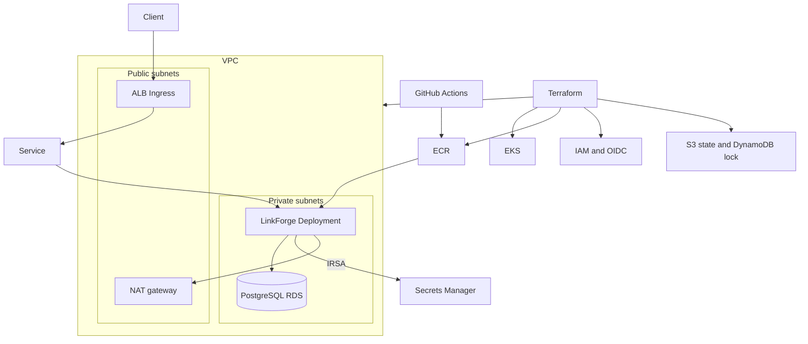

# LinkForge on AWS EKS

**Live demo:** [https://taha080.github.io/aws-eks-devops-platform/](https://taha080.github.io/aws-eks-devops-platform/)

[](https://github.com/taha080/aws-eks-devops-platform/actions/workflows/ci.yml)
[](LICENSE)

LinkForge is a small URL shortener packaged the way a platform team would run it: a Python API, a container image, a Helm release on EKS, and Terraform for the AWS account around it. Everything that can be checked without an AWS account is checked in CI. Nothing in this repository is a live credential, an account ID, or a state file.

Built by [Taha Ahsan](https://github.com/taha080).

## What it does

The API stores a target URL under a short code and redirects callers to it. The [live demo](https://taha080.github.io/aws-eks-devops-platform/) does the same in the browser: paste a URL, copy the short link, and open `#/code`, which counts a click and redirects. Give that page an API base URL and it calls this service instead.

| Method | Path | Purpose |
| --- | --- | --- |
| `GET` | `/healthz` | Liveness |
| `GET` | `/readyz` | Readiness, including a database check |
| `GET` | `/metrics` | Prometheus metrics |
| `POST` | `/v1/links` | Create a short link |
| `GET` | `/v1/links` | List links |
| `GET` | `/v1/links/{code}` | Fetch one link |
| `DELETE` | `/v1/links/{code}` | Delete a link |
| `GET` | `/{code}` | Redirect with `302` and count the click |

Write routes stay open when `LINKFORGE_API_TOKEN` is empty, which is the local default. Set the token and those routes require `Authorization: Bearer`. Redirects, probes, and metrics stay public.

Configuration is environment variables prefixed with `LINKFORGE_`. `LINKFORGE_DATABASE_URL` selects SQLite or PostgreSQL. If that is empty and `LINKFORGE_DB_SECRET_ARN` is set, the process reads an RDS-managed secret with the AWS SDK, which is how the pod uses IRSA on EKS. Logs are JSON on stdout. Each process has its own Prometheus registry so tests do not share counters.

## Architecture



Dev runs one replica with SQLite on an emptyDir, so it can be exercised without RDS. Prod turns on a private PostgreSQL instance, two or more replicas, an HPA, and a PodDisruptionBudget. SQLite is not shared across pods, and the Helm chart refuses to render more than one replica unless `database.external` is true.

The managed node group sits in the private subnets. Public subnets are tagged for internet-facing load balancers and do not auto-assign public addresses. NAT is one gateway in dev and one per availability zone in prod. The Kubernetes API is private by default. Turn on `endpoint_public_access` and set `public_access_cidrs` to your own network when you want kubectl from a laptop. A GitHub-hosted runner cannot reach a private API, so the Helm step in the deploy workflow needs that public endpoint or a self-hosted runner inside the VPC. Terraform itself only talks to the AWS API.

## Tech stack

- Python 3.12, FastAPI, SQLAlchemy, Prometheus client, pytest, ruff, bandit
- Docker multi-stage build, non-root user, docker compose
- Terraform 1.6+ and the AWS provider 6.x
- Amazon VPC, EKS managed node group, ECR, IAM OIDC, optional RDS
- Helm chart: Deployment, Service, Ingress, HPA, ConfigMap, probes, resources, PodDisruptionBudget
- kind for a local cluster
- GitHub Actions

## Repository layout

```text
app/                     FastAPI service, tests, and Dockerfile
web/                     Static demo published to GitHub Pages
deploy/helm/linkforge/   Helm chart and dev, prod, and kind values
deploy/kind/             kind cluster config
deploy/prometheus/       Optional local scrape config
infra/bootstrap/         S3 state bucket and DynamoDB lock table
infra/modules/           vpc, eks, ecr, rds, iam-irsa, and the platform composition
infra/envs/dev/          Small cluster, single NAT, no RDS
infra/envs/prod/         Three AZs, NAT per AZ, Multi-AZ RDS
scripts/                 Validate, kind deploy, and RDS URL rendering
.github/workflows/       CI, manual AWS deploy, and GitHub Pages
```

## Run it locally

Python 3.11 or newer:

```bash
make install
make test
make lint
uvicorn linkforge.main:app --app-dir app/src --port 8000
```

Create a link and follow it:

```bash
curl -s -X POST localhost:8000/v1/links \
  -H 'content-type: application/json' \
  -d '{"target_url":"https://example.com","code":"demo"}'
curl -I localhost:8000/demo
curl -s localhost:8000/metrics | head
```

Docker Compose builds the same image CI builds. The API listens on port 8000 and keeps the SQLite file in a volume.

```bash
docker compose up --build
```

Postgres and Prometheus are optional profiles, for local use only:

```bash
docker compose --profile postgres --profile metrics up --build
```

The Postgres password in the compose file is a local default, not a production secret.

A kind cluster is optional and needs Docker, kind, kubectl, and Helm:

```bash
make kind-deploy
```

That publishes the Service on http://127.0.0.1:8080/healthz.

`make ci` runs lint, tests, bandit, Terraform, and Helm. It also builds the image when Docker is on the machine.

## Deploy to AWS

CI does not need AWS. A real apply does. Use a throwaway account if you are learning the stack. The resources below cost money until you destroy them.

1. Create a GitHub OIDC role that this repository can assume, plus the Actions secrets `AWS_ROLE_ARN`, `AWS_REGION`, `TF_STATE_BUCKET`, and `TF_STATE_LOCK_TABLE` on the `dev` and `prod` GitHub Environments. Do not put those values in the repo.
2. Bootstrap the remote state once. Pick a globally unique bucket name.

   ```bash
   cd infra/bootstrap
   terraform init
   terraform apply -var state_bucket_name=linkforge-tfstate-CHANGE-ME
   ```

3. Copy `infra/envs/dev/backend.hcl.example` to `backend.hcl` and fill in the bucket from the bootstrap outputs. `backend.hcl` is gitignored.

   ```bash
   cd infra/envs/dev
   terraform init -backend-config=backend.hcl
   terraform plan
   terraform apply
   ```

4. Build and push the image, then install the chart. `terraform output` prints the repository URL, the cluster name, and the IRSA role ARN. None of those are committed. `aws eks update-kubeconfig` only works from a network that can reach the API.

   ```bash
   aws ecr get-login-password | docker login --username AWS --password-stdin "<registry>"
   docker build -t "<repository>:$(git rev-parse HEAD)" app
   docker push "<repository>:$(git rev-parse HEAD)"
   aws eks update-kubeconfig --name linkforge-dev --region us-east-1
   helm upgrade --install linkforge deploy/helm/linkforge \
     --namespace linkforge --create-namespace \
     -f deploy/helm/linkforge/values-dev.yaml \
     --set image.repository="<repository>" \
     --set image.tag="$(git rev-parse HEAD)" \
     --set serviceAccount.roleArn="<irsa role arn>"
   ```

Prod is the same flow in `infra/envs/prod` with `values-prod.yaml`. Prod creates RDS and expects a Secret named `linkforge-db` whose key `LINKFORGE_DATABASE_URL` is a `postgresql+psycopg://` URL. The deploy workflow builds that URL from the RDS-managed secret and does not write the password to the log. You can do the same locally with `scripts/render-db-url.py`, which reads the secret JSON on stdin.

The example tfvars show how to open the API to a single address. They do not contain an account ID. EKS Kubernetes 1.35 is pinned because it is in standard support. The module description notes that 1.37 is the current EKS release as of October 2026 if you want to move forward.

The AWS Load Balancer Controller is not installed by Terraform. The Ingress uses the `alb` class and the usual annotations, so install the controller before expecting an address. Dev can also be reached with `kubectl port-forward`.

## CI/CD

`.github/workflows/ci.yml` runs on pull requests and on pushes to `main`:

- ruff and pytest
- `docker build`
- `terraform fmt -check` and `terraform validate` with `-backend=false` for bootstrap, dev, and prod
- `helm lint` and `helm template` for the default, dev, prod, and kind values
- bandit, plus a Trivy filesystem scan for high and critical findings

No job assumes a cloud role. Provider plugins are downloaded during `terraform init`, and validation does not call AWS.

`.github/workflows/deploy.yml` is `workflow_dispatch` only. The first step checks that the four secrets exist. If any are missing it prints that and the rest of the job is skipped, so the workflow does not fail on a repository that has never been wired to AWS. When the secrets are present it applies the selected environment, pushes the image to ECR, and upgrades the Helm release. Treat the prod GitHub Environment as protected. `terraform apply -auto-approve` is what that manual run does.

`.github/workflows/pages.yml` publishes `web/` to [GitHub Pages](https://taha080.github.io/aws-eks-devops-platform/) when `main` changes the site. It does not use AWS credentials, and it is not part of the CI jobs above.

## Cost and teardown

The control plane is the expensive always-on piece, on the order of $0.10 per hour per cluster. NAT gateways are the other one: dev uses a single NAT, prod uses one in each of three zones, and both bill for hours and data. Nodes are `t3.small` in dev and `t3.medium` in prod. Prod also adds a Multi-AZ `db.t4g.small`. ECR, CloudWatch logs, and the state bucket are small next to those.

Destroy the environment before the state backend:

```bash
cd infra/envs/dev    # or prod
terraform destroy
```

ECR repositories are created with `force_delete` so leftover images do not block destroy. RDS deletion protection is off and the final snapshot is skipped so this sample can be removed in one destroy. Turn both of those on if you ever point the module at data you need to keep. Cluster deletion protection is also off for the same reason. Prod enables VPC flow logs, which add CloudWatch cost. The EKS upgrade policy is `STANDARD`, so a cluster is not left on extended support by accident.

After the environment stacks are gone, `terraform destroy` in `infra/bootstrap` removes the lock table and the state bucket. Empty the bucket first if versioning has retained objects.

## Skills this repo is here to show

- A service with health checks, metrics, structured logs, env-based config, and tests that do not need a cloud account
- A non-root multi-stage image and a compose file that matches it
- Terraform modules for a private-node EKS platform, IRSA, ECR, and an optional RDS instance whose password stays in Secrets Manager
- A Helm release that encodes replica, probe, resource, and disruption defaults, and refuses an unsafe SQLite topology
- CI that stays green with no secrets, and a deploy workflow that refuses to call AWS until credentials exist

## License

[MIT](LICENSE). Copyright 2026 Taha Ahsan.
